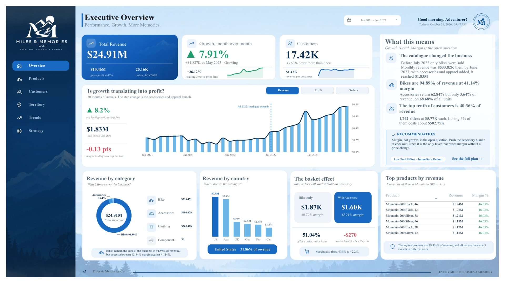
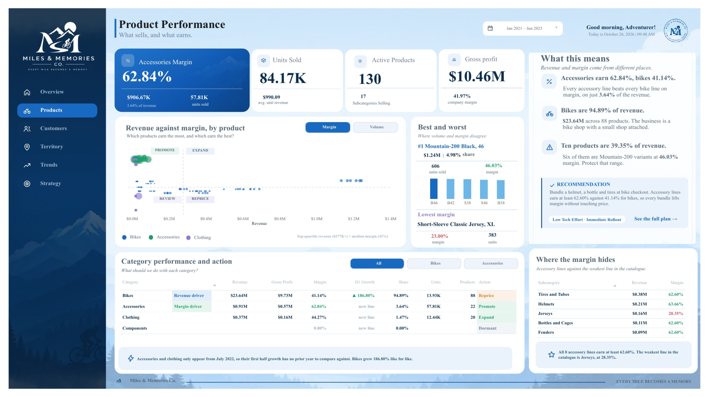
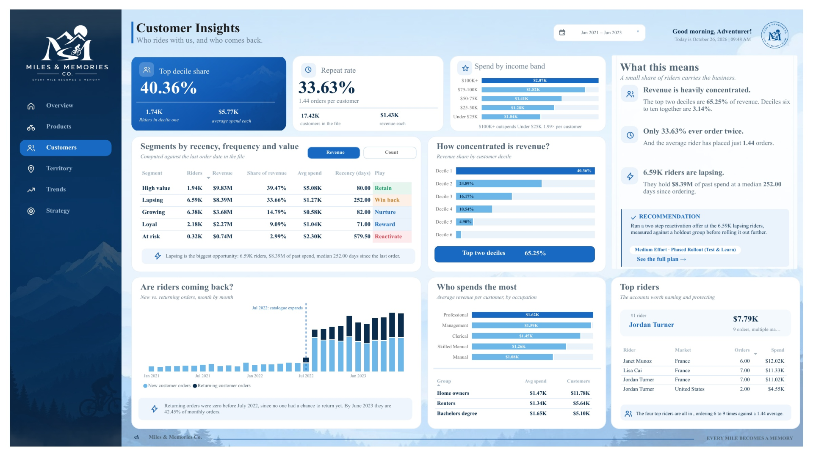
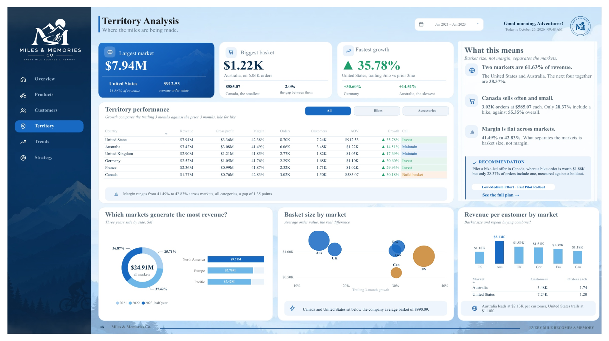
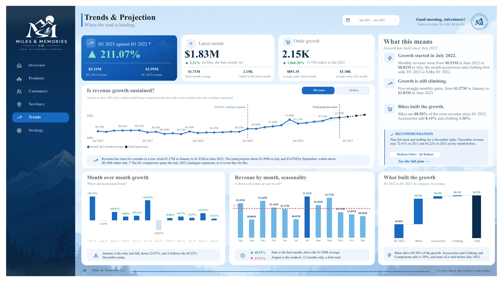
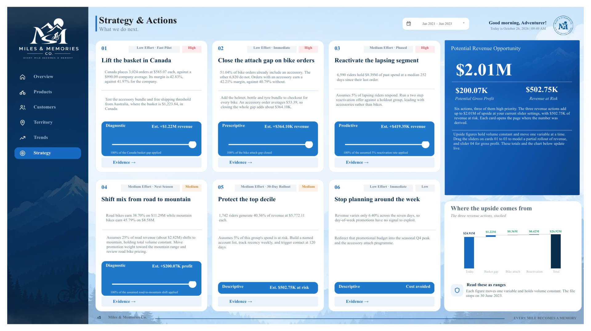

# Miles & Memories Co. Executive Dashboard

**A six page Power BI dashboard that turns two and a half years of bike sales into clear decisions.**



> Case study: [Capstone-Case-Study.pdf](Capstone-Case-Study.pdf) (59 pages, how I built it and why)
> Dashboard export: [Dashboard-Export.pdf](Dashboard-Export.pdf) (all six pages)

## The business problem

Miles & Memories Co. is a fictional cycling and outdoor retailer. Sales were going up, but nobody could say why, which customers mattered most, or where to put money and effort next.

My problem statement was:

> Where does our growth really come from, who and what is carrying us, and which actions will raise revenue and margin the most?

## What I built

| | |
|---|---|
| Dashboard pages | 6 |
| DAX measures | 255 |
| Tables in the model | 27 |
| Sales rows analysed | 56,046 |
| Period | 1 January 2021 to 30 June 2023 (30 months) |

Every number, caption and colour on the dashboard comes from a measure, so nothing is typed by hand. When the date picker moves, everything moves with it, including the basket effect.

## The six pages

| Page | Question it answers | Recommended action |
|---|---|---|
| Overview | Is growth translating into profit? | Push the accessory bundle at checkout |
| Products | Which products earn the revenue and which earn the margin? | Bundle a helmet, a bottle and tires with every bike |
| Customers | Who is carrying the business? | Run a two step reactivation offer for lapsing riders |
| Territory | Where are the miles being made? | Pilot a bike-led offer in Canada |
| Trends | Is revenue growth sustained, and what comes next? | Plan Q4 stock and staffing for the December spike |
| Strategy | What do we do next? | Lift the Canada basket and close the bike attach gap first |







## Key findings

- **Growth is real.** Monthly revenue went from about $0.53M before July 2022 to $1.83M in June 2023. H1 2023 is 3.11 times H1 2022.
- **The catalogue caused it.** Accessories and clothing launched in July 2022, and bikes still brought 88.50% of the extra revenue.
- **Margin is the open question.** Margin slipped 0.13 points while sales grew.
- **Money is concentrated.** Bikes are 94.89% of revenue, and the top 10% of customers bring in 40.36%.
- **The next dollars are in baskets and returning riders.** Canada's baskets are small, only 28.37% of Canadian orders include a bike, and 6.59K riders have gone quiet.
- **The three revenue gaps add up to $2.01M** at the default settings on the Strategy page.

## Features

- **Date picker pill with a month list** on every page. It shows the range in view, such as Jan 2021 – Jun 2023, and every card, chart and sentence recalculates when months are picked.
- **Basket effect that follows the dates.** The bike only and bike plus accessory numbers are rebuilt from the sales table for the dates picked, so they move with the date picker.
- **Revenue, Profit and Orders toggle** on the Overview chart, and **Revenue and Orders toggle** on the Trends chart, built with bookmarks and hidden slicers, with the same blue and light-blue buttons on every page.
- **Straight line projection** for July to September 2023, fitted on the 12 months since the catalogue expanded, with an 80% range.
- **Strategy sliders** that let a leader be careful or hopeful and see the revenue estimate change right away.
- **Measure-driven text.** Titles, subtitles and the "What this means" sentences are written by DAX from live numbers.
- **Custom JSON theme** and a consistent layout across all six pages.

## Tools and skills

Power BI Desktop, DAX (iterators, time intelligence, ranking, linear regression), Power Query, data modelling (star schema with one snowflake branch), bookmarks and selection pane, conditional formatting, dashboard design and storytelling.

## Data

The data is the AdventureWorks sample dataset from my data analytics bootcamp, loaded from CSV files. I gave it a fictional brand, a logo, a colour palette and a story. Miles & Memories Co. is not a real company.

## How to view the dashboard

1. Scroll up to see a screenshot of every page.
2. Open [Dashboard-Export.pdf](Dashboard-Export.pdf) to see all six pages at full size.
3. Open [Capstone-Case-Study.pdf](Capstone-Case-Study.pdf) to read how and why I built each page.

The Power BI file (.pbix) is not in this repository. It is available on request, or I am happy to walk through it live.

## What is in this repository

```
README.md                    (this page)
Capstone-Case-Study.pdf     (59 pages, how I built it and why)
Dashboard-Export.pdf        (all six pages at full size)
1-overview.png ... 6-strategy.png   (one screenshot per page)
1-Measure.md                (DAX measures, folder _Measure)
2-Calculate.md              (DAX measures, folder _Calculate)
3-TIME-INT.md               (DAX measures, folder _TIME INT)
4-Helper-tables.md          (helper measures for sliders and selectors)
```

The four `.md` files hold the formula for every one of the 255 measures. Appendix A of the case study ranks them by how much the dashboard depends on each one, with a plain English reason for each.

## About me

I am Cristine Angelica Marie Serrano Tolentino (Angelica), a Business Intelligence Analyst and Data Analyst based in the Philippines. This was my capstone project for the DataSense Analytics Data Analyst Specialist program.
